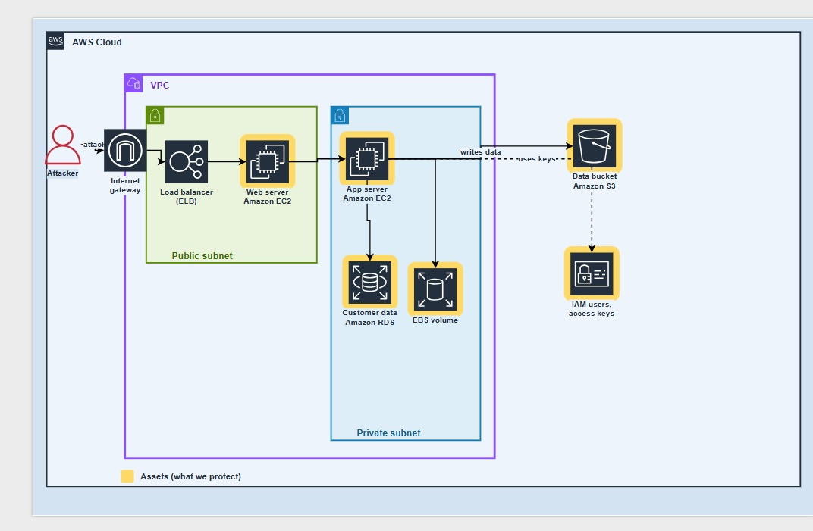
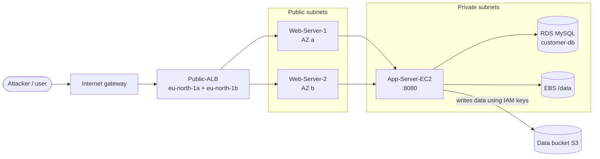
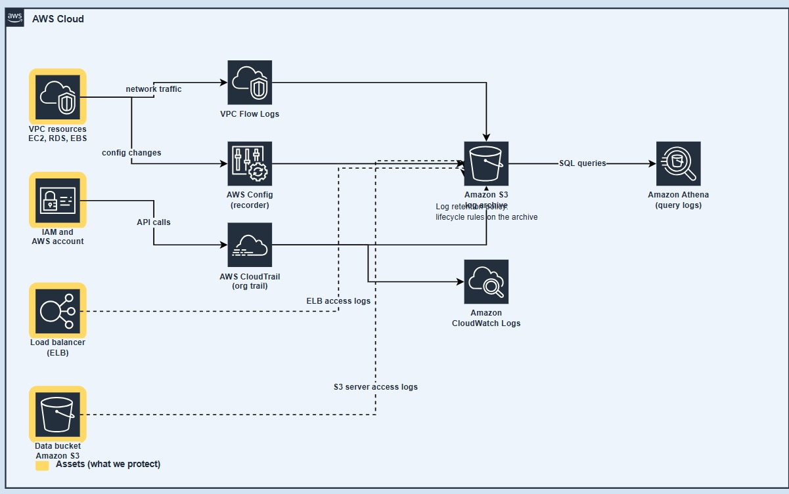
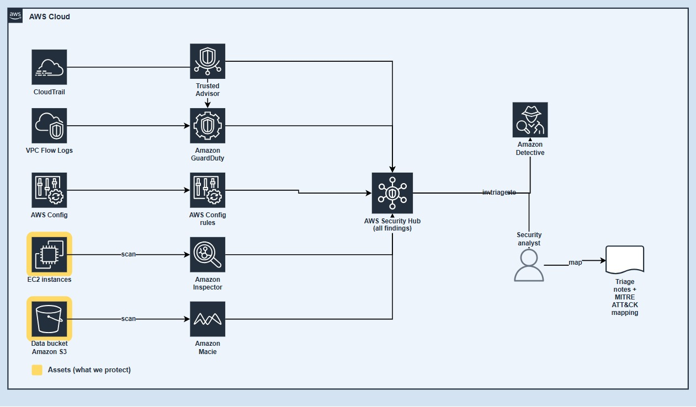
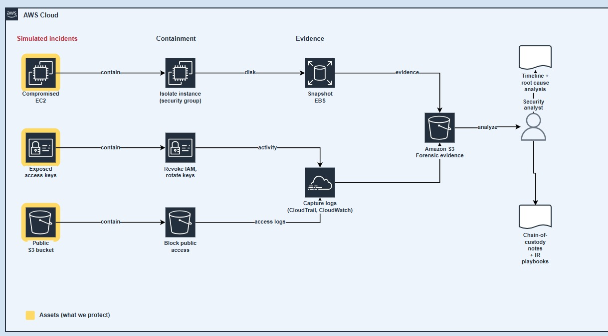
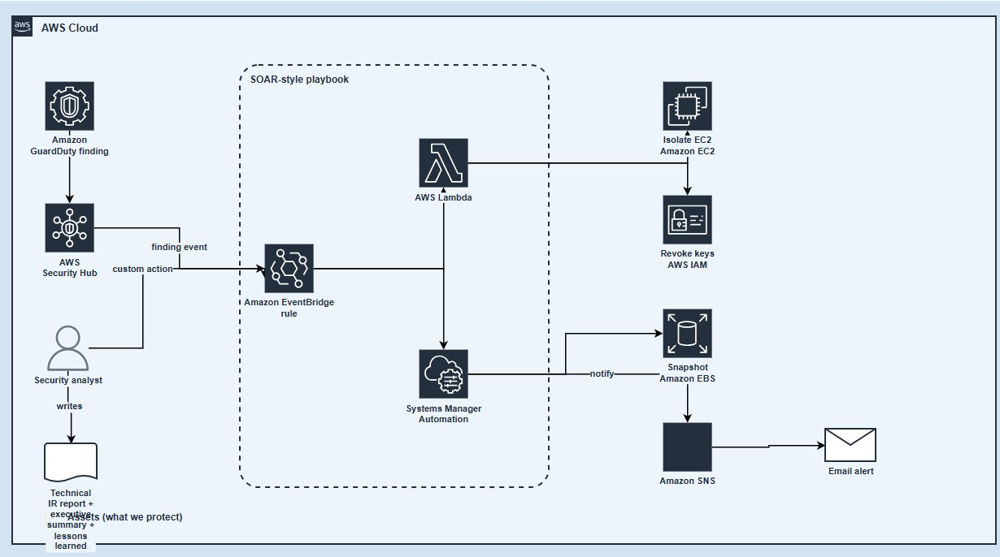

# 🛡️ AWS Cloud Incident Response & Automated Threat Detection Pipeline (SOAR)

## Project Architecture


A hands-on, step-by-step lab that builds a small AWS environment, collects and analyses its logs, detects threats, simulates three incidents, investigates them, and finally automates the response (SOAR).

Everything is done in **one region: Europe (Stockholm) `eu-north-1`**. Follow the phases **in order** – each step only depends on steps above it.

> ⚠️ **Cost & safety.** ALB, RDS, GuardDuty, Inspector, Macie, Detective and Config are billed. Use a dedicated lab account, use **fake data only**, and run the [Clean-up](#-clean-up) section when you finish.

## 📋 Table of contents

0. [Architecture overview](#-architecture-overview)
1. [Phase 0 – Prerequisites](#-phase-0--prerequisites)
2. [Phase 1 – Target infrastructure & assets](#-phase-1--target-infrastructure--assets)
3. [Phase 2 – Centralized logging & analytics](#-phase-2--centralized-logging--analytics)
4. [Phase 3 – Threat detection & security monitoring](#-phase-3--threat-detection--security-monitoring)
5. [Phase 4 – Incident simulation & forensic evidence](#-phase-4--incident-simulation--forensic-evidence)
6. [Phase 5 – Automated SOAR response](#-phase-5--automated-soar-response)
7. [Clean-up](#-clean-up) · [Troubleshooting](#-troubleshooting)

---

## 📐 Architecture overview

| Phase | What you build                                                                                                       | Diagram                                    |
| ----- | -------------------------------------------------------------------------------------------------------------------- | ------------------------------------------ |
| 1     | VPC, **ALB → 2 web servers (EC2) → app server (EC2) → RDS + EBS + S3**, IAM user with access keys                    | `docs/images/01-target-infrastructure.png` |
| 2     | Central S3 log archive fed by CloudTrail, VPC Flow Logs, AWS Config, ELB logs and S3 access logs; Athena for queries | `docs/images/02-centralized-logging.png`   |
| 3     | GuardDuty, Inspector, Macie, Config rules → Security Hub → Detective → analyst triage + MITRE ATT&CK                 | `docs/images/03-detection-monitoring.png`  |
| 4     | Three simulated incidents → containment → evidence → timeline, RCA, chain of custody                                 | `docs/images/04-incident-simulation.png`   |
| 5     | Security Hub → EventBridge → Lambda + Systems Manager Automation → SNS email                                         | `docs/images/05-soar-playbook.png`         |

```
[ Phase 1: Target infrastructure ] ──► [ Phase 2: Central logging archive ] ──► [ Phase 3: Detection + Security Hub ]
                                                                                          │
[ Phase 5: Automated SOAR playbooks ] ◄── [ Phase 4: Incident simulation + forensic evidence ] ◄┘
```



> The Phase 1 diagram shows one web server. **This lab runs two web servers behind the load balancer** (one per Availability Zone), as in the diagram below. This also lets you see the load balancer fail over when you isolate one of them in Phase 4.



### Repository layout

```
README.md
docs/images/            the 5 architecture diagrams
webapp/web/             static site served by the web servers (index, simulate, css, js)
webapp/app/server.py    app-tier API (stdlib Python)
scripts/                EC2 user-data: web-userdata.sh, app-userdata.sh   (generated)
policies/               bucket policy, IAM and EventBridge JSON
athena/                 SQL: tables + investigation queries
lambda/soar_responder.py    SOAR Lambda
ssm/forensic-snapshot-runbook.yaml   SSM Automation runbook
tools/build.py          regenerates scripts/ and README.md from the sources above
```

---

## ✅ Phase 0 – Prerequisites

1. A **dedicated AWS account** with an admin user protected by MFA. Create a **Budget** (Billing → Budgets → e.g. 30 USD) so you get warned about costs.
2. In the console, switch to **Europe (Stockholm) `eu-north-1`** and stay there. (Exceptions: IAM, and CloudTrail/Security Hub aggregation views, which are global/regional by nature.)
3. Note your **12-digit account ID** (top-right menu). Choose a short unique **suffix** (for example your initials + 4 digits) – S3 bucket names are global. Write these values down; the rest of the guide uses them:

| Placeholder         | Example                               | Used for                    |
| ------------------- | ------------------------------------- | --------------------------- |
| `<ACCOUNT_ID>`      | `123456789012`                        | policies, ARNs              |
| `<SUFFIX>`          | `kh4821`                              | unique bucket names         |
| `<DATA_BUCKET>`     | `target-data-bucket-ir-lab-<SUFFIX>`  | app data (Phase 1)          |
| `<LOG_BUCKET>`      | `central-log-archive-ir-lab-<SUFFIX>` | log archive (Phase 2)       |
| `<EVIDENCE_BUCKET>` | `forensic-evidence-ir-lab-<SUFFIX>`   | forensic evidence (Phase 4) |

4. Create an **EC2 key pair** (EC2 → Key pairs → Create, name `ir-lab-key`, `.pem`) for SSH.
5. Open **AWS CloudShell** (icon in the top bar) – we use it for a few CLI commands.

---

## 🏗️ Phase 1 – Target infrastructure & assets

### Step 1.1 – Create the VPC

1. **VPC console → Your VPCs → Create VPC** → **VPC only**.
   - Name: `IR-VPC` · IPv4 CIDR: `10.0.0.0/16` → **Create VPC**.

### Step 1.2 – Internet gateway

1. **Internet gateways → Create internet gateway** → name `IR-IGW` → Create.
2. **Actions → Attach to VPC** → `IR-VPC`.

### Step 1.3 – Four subnets (two Availability Zones)

An Application Load Balancer **needs subnets in at least two AZs**, and an RDS subnet group needs two as well – so we create a public and a private subnet in each of two AZs.

**Subnets → Create subnet** → VPC `IR-VPC`, then add all four:

| Name               | AZ            | CIDR           |
| ------------------ | ------------- | -------------- |
| `Public-Subnet-A`  | `eu-north-1a` | `10.0.1.0/24`  |
| `Public-Subnet-B`  | `eu-north-1b` | `10.0.2.0/24`  |
| `Private-Subnet-A` | `eu-north-1a` | `10.0.11.0/24` |
| `Private-Subnet-B` | `eu-north-1b` | `10.0.12.0/24` |

For **both public subnets**: select it → **Actions → Edit subnet settings → Enable auto-assign public IPv4 address** → Save.

### Step 1.4 – Route tables

1. **Route tables → Create route table** → name `Public-RT`, VPC `IR-VPC`.
   - **Routes → Edit routes → Add route**: `0.0.0.0/0` → target **Internet Gateway** `IR-IGW`.
   - **Subnet associations → Edit** → select `Public-Subnet-A` and `Public-Subnet-B`.
2. **Create route table** → name `Private-RT`, VPC `IR-VPC` (no internet route).
   - **Subnet associations** → select `Private-Subnet-A` and `Private-Subnet-B`.

### Step 1.5 – S3 gateway endpoint (so the private app server can install packages and reach S3)

The app server has no internet access. A free **gateway endpoint** lets it reach S3 – including the Amazon Linux package repositories, which are hosted on S3.

1. **VPC → Endpoints → Create endpoint**, name `IR-S3-Endpoint`.
2. Service category **AWS services** → search `s3` → choose `com.amazonaws.eu-north-1.s3` of type **Gateway**.
3. VPC `IR-VPC` → Route tables: tick **`Private-RT`** → Create.

### Step 1.6 – Security groups

**VPC → Security groups → Create security group** (VPC `IR-VPC`). Create them in this order, because each references the previous one:

| #   | Name            | Inbound rules                                                                 |
| --- | --------------- | ----------------------------------------------------------------------------- |
| 1   | `ALB-SG`        | HTTP `80` from `0.0.0.0/0`                                                    |
| 2   | `Web-Server-SG` | HTTP `80` from **`ALB-SG`**; SSH `22` from **My IP**                          |
| 3   | `App-Server-SG` | Custom TCP `8080` from **`Web-Server-SG`**; SSH `22` from **`Web-Server-SG`** |
| 4   | `DB-SG`         | MySQL/Aurora `3306` from **`App-Server-SG`**                                  |

Leave outbound as the default (all traffic). _(HTTPS needs a certificate/domain; the lab uses HTTP to stay simple.)_

### Step 1.7 – Target S3 data bucket (with fake data for Macie)

1. **S3 → Create bucket** → name `<DATA_BUCKET>`, region `eu-north-1`, keep **Block all public access = ON**, Create.
2. In **CloudShell**, create a small file of **fake** records and upload it (Macie will find the "card" number in Phase 3):

```bash
cat > sample-customers.csv <<'CSV'
name,email,card_number,note
Alice Example,alice@example.com,4111111111111111,test card
Bob Example,bob@example.com,5555555555554444,test card
Carol Example,carol@example.com,378282246310005,test card
CSV
aws s3 cp sample-customers.csv s3://<DATA_BUCKET>/sensitive/sample-customers.csv
```

### Step 1.8 – IAM user and access keys for the app

1. **IAM → Policies → Create policy → JSON** – paste (replace `<DATA_BUCKET>`), name it `AppStorageAccess`:

```json
{
  "Version": "2012-10-17",
  "Statement": [
    {
      "Effect": "Allow",
      "Action": ["s3:PutObject", "s3:GetObject", "s3:ListBucket"],
      "Resource": ["arn:aws:s3:::<DATA_BUCKET>", "arn:aws:s3:::<DATA_BUCKET>/*"]
    }
  ]
}
```

2. **IAM → Users → Create user** → `app-storage-user` (no console access) → **Attach policies directly** → `AppStorageAccess`.
3. Open the user → **Security credentials → Create access key** → use case _Application running outside AWS_ → **copy the Access key ID and Secret access key** (shown once).

### Step 1.9 – RDS database (takes ~10 min – start it now)

1. **RDS → Subnet groups → Create DB subnet group**: name `ir-db-subnets`, VPC `IR-VPC`, AZs `eu-north-1a` + `eu-north-1b`, subnets `Private-Subnet-A` + `Private-Subnet-B`.
2. **RDS → Create database** → **Standard create** → **MySQL** → template **Free tier** (or _Dev/Test_, single-AZ).
   - DB instance identifier: `customer-db`
   - Master username: `admin` · set a password (write it down; use letters and digits only – no spaces, quotes, `#`, `$` or `\`, because it is placed in a config file later)
   - Instance class: `db.t3.micro` (or `db.t4g.micro`)
   - Connectivity: VPC `IR-VPC`, subnet group `ir-db-subnets`, **Public access: No**, security group **`DB-SG`** (remove `default`)
   - **Additional configuration → Initial database name: `customerdb`**
3. Create. When the status is **Available**, copy the **Endpoint** (`customer-db.xxxx.eu-north-1.rds.amazonaws.com`).

### Step 1.10 – App server (private subnet) with an EBS data volume

1. Open `scripts/app-userdata.sh` from this repo and **edit the variables at the top**: `DB_HOST` (RDS endpoint), `DB_PASS`, `DATA_BUCKET`, `AWS_ACCESS_KEY_ID`, `AWS_SECRET_ACCESS_KEY`.
2. **EC2 → Launch instance**:
   - Name `App-Server-EC2` · AMI **Amazon Linux 2023** · type `t3.micro` · key pair `ir-lab-key`
   - Network: VPC `IR-VPC`, subnet **`Private-Subnet-A`**, **Auto-assign public IP: Disable**, security group **`App-Server-SG`**
   - Storage: keep the 8 GiB root volume and **Add new volume**: `8 GiB`, `gp3`, device `/dev/sdf` ← this is the **EBS volume** from the diagram
   - **Advanced details → User data**: paste the whole edited `scripts/app-userdata.sh`
3. Launch. Copy the instance's **Private IPv4 address** (you need it in the next step).

> The user script installs the MySQL client, mounts the EBS volume on `/data`, and runs `webapp/app/server.py` as a systemd service on port **8080**. The access keys sit in `/etc/lab-app.env` – on purpose, this is the "exposed keys" scenario of Phase 4.
> In a real system you would use an IAM _role_ (no keys) and Secrets Manager. User data is readable in the console – **lab only**.

### Step 1.11 – Two web servers (one per AZ)

1. Open `scripts/web-userdata.sh` and set `APP_SERVER_IP` to the app server's private IP.
2. Launch **two** instances, one after the other (EC2 → Launch instance; for the second use **Launch more like this** and change the name and subnet):

| Name           | Subnet                            | Other settings (both)                                                                                                                                 |
| -------------- | --------------------------------- | ----------------------------------------------------------------------------------------------------------------------------------------------------- |
| `Web-Server-1` | `Public-Subnet-A` (`eu-north-1a`) | AMI Amazon Linux 2023, `t3.micro`, key `ir-lab-key`, **auto-assign public IP: Enable**, SG **`Web-Server-SG`**, User data = `scripts/web-userdata.sh` |
| `Web-Server-2` | `Public-Subnet-B` (`eu-north-1b`) | same as above                                                                                                                                         |

The script installs nginx, publishes the **SecureCart Lab** site (`webapp/web/`), writes `/instance.json` (instance ID + AZ, shown in the page badge) and proxies `/api/` to the app server.

### Step 1.12 – Target group and Application Load Balancer

1. **EC2 → Target groups → Create target group**
   - Type **Instances** · name `web-tg` · HTTP `80` · VPC `IR-VPC`
   - **Health check path: `/health`**
   - Register **both** `Web-Server-1` and `Web-Server-2` (_Include as pending below_) → Create.
2. **EC2 → Load balancers → Create → Application Load Balancer**
   - Name `Public-ALB` · **Internet-facing** · IPv4
   - Network mapping: VPC `IR-VPC`, tick **`eu-north-1a` → Public-Subnet-A** and **`eu-north-1b` → Public-Subnet-B**
   - Security group **`ALB-SG`** (remove `default`)
   - Listener **HTTP:80 → forward to `web-tg`** → Create.
3. Wait until the state is **Active**; copy the **DNS name**.

### Step 1.13 – Test the whole stack

1. EC2 → Target groups → `web-tg` → **Targets**: wait until **both** are **healthy** (a few minutes).
2. Open `http://<ALB-DNS-NAME>/`. **Refresh several times** – the badge in the top-right switches between the two instance IDs/AZs.
3. Add a customer in the form. You should see _"Saved! … stored in RDS, the EBS volume and S3"_, and the customer appears in the table.
4. Verify each storage tier (use `Web-Server-1` as a jump host to reach the private app server):

```bash
# from your laptop (load the key into an agent so the jump works)
ssh-add ir-lab-key.pem
ssh -A -J ec2-user@<WEB1_PUBLIC_IP> ec2-user@<APP_PRIVATE_IP>

# on the app server:
df -h /data                          # EBS volume mounted
sudo tail -n 3 /data/lab/customers.log   # EBS copy of the records
sudo systemctl status lab-app --no-pager # service running
```

and in the console: **S3 → `<DATA_BUCKET>` → `customers/`** has one JSON file per customer; the RDS row can be checked with `mysql -h <RDS_ENDPOINT> -u admin -p customerdb -e "select name,email from customers"` from the app server. 5. **Failover check:** on `Web-Server-1` run `sudo systemctl stop nginx`; after ~30 s the target shows _unhealthy_ and the site keeps working through `Web-Server-2`. Start it again: `sudo systemctl start nginx`.

✅ **Phase 1 done** – you have the assets (yellow boxes in the diagram) to protect.

---

## 📊 Phase 2 – Centralized logging & analytics



### Step 2.1 – Create the central log archive bucket

1. **S3 → Create bucket** → `<LOG_BUCKET>`, region `eu-north-1`.
   - **Object Ownership: ACLs disabled (bucket owner enforced)** (default)
   - **Block all public access: ON**
   - **Bucket Versioning: Enable**
   - **Default encryption: SSE-S3** ⚠️ _Do not use SSE-KMS – ALB log delivery does not support it and fails with "Access Denied"._

### Step 2.2 – Bucket policy for all the log sources

**S3 → `<LOG_BUCKET>` → Permissions → Bucket policy → Edit**. Paste the policy below and replace the three placeholders `<LOG_BUCKET>`, `<DATA_BUCKET>`, `<ACCOUNT_ID>` (use _Find & replace_ in your editor first).

It authorises, each with the narrowest path possible: ELB (access + connection logs), VPC Flow Logs, CloudTrail, AWS Config, and S3 server access logs – and denies non-TLS access.

```json
{
  "Version": "2012-10-17",
  "Statement": [
    {
      "Sid": "DenyInsecureTransport",
      "Effect": "Deny",
      "Principal": "*",
      "Action": "s3:*",
      "Resource": ["arn:aws:s3:::<LOG_BUCKET>", "arn:aws:s3:::<LOG_BUCKET>/*"],
      "Condition": { "Bool": { "aws:SecureTransport": "false" } }
    },
    {
      "Sid": "AllowELBLogDelivery",
      "Effect": "Allow",
      "Principal": {
        "Service": "logdelivery.elasticloadbalancing.amazonaws.com"
      },
      "Action": "s3:PutObject",
      "Resource": "arn:aws:s3:::<LOG_BUCKET>/elb-logs/AWSLogs/<ACCOUNT_ID>/*"
    },
    {
      "Sid": "AllowLogDeliveryAclCheck",
      "Effect": "Allow",
      "Principal": { "Service": "delivery.logs.amazonaws.com" },
      "Action": "s3:GetBucketAcl",
      "Resource": "arn:aws:s3:::<LOG_BUCKET>",
      "Condition": { "StringEquals": { "aws:SourceAccount": "<ACCOUNT_ID>" } }
    },
    {
      "Sid": "AllowVpcFlowLogsWrite",
      "Effect": "Allow",
      "Principal": { "Service": "delivery.logs.amazonaws.com" },
      "Action": "s3:PutObject",
      "Resource": "arn:aws:s3:::<LOG_BUCKET>/AWSLogs/<ACCOUNT_ID>/*",
      "Condition": {
        "StringEquals": {
          "aws:SourceAccount": "<ACCOUNT_ID>",
          "s3:x-amz-acl": "bucket-owner-full-control"
        }
      }
    },
    {
      "Sid": "AllowCloudTrailAclCheck",
      "Effect": "Allow",
      "Principal": { "Service": "cloudtrail.amazonaws.com" },
      "Action": "s3:GetBucketAcl",
      "Resource": "arn:aws:s3:::<LOG_BUCKET>",
      "Condition": { "StringEquals": { "aws:SourceAccount": "<ACCOUNT_ID>" } }
    },
    {
      "Sid": "AllowCloudTrailWrite",
      "Effect": "Allow",
      "Principal": { "Service": "cloudtrail.amazonaws.com" },
      "Action": "s3:PutObject",
      "Resource": "arn:aws:s3:::<LOG_BUCKET>/AWSLogs/<ACCOUNT_ID>/CloudTrail/*",
      "Condition": {
        "StringEquals": {
          "aws:SourceAccount": "<ACCOUNT_ID>",
          "s3:x-amz-acl": "bucket-owner-full-control"
        }
      }
    },
    {
      "Sid": "AllowConfigAclAndListCheck",
      "Effect": "Allow",
      "Principal": { "Service": "config.amazonaws.com" },
      "Action": ["s3:GetBucketAcl", "s3:ListBucket"],
      "Resource": "arn:aws:s3:::<LOG_BUCKET>",
      "Condition": { "StringEquals": { "aws:SourceAccount": "<ACCOUNT_ID>" } }
    },
    {
      "Sid": "AllowConfigWrite",
      "Effect": "Allow",
      "Principal": { "Service": "config.amazonaws.com" },
      "Action": "s3:PutObject",
      "Resource": "arn:aws:s3:::<LOG_BUCKET>/AWSLogs/<ACCOUNT_ID>/Config/*",
      "Condition": {
        "StringEquals": {
          "aws:SourceAccount": "<ACCOUNT_ID>",
          "s3:x-amz-acl": "bucket-owner-full-control"
        }
      }
    },
    {
      "Sid": "AllowS3ServerAccessLogs",
      "Effect": "Allow",
      "Principal": { "Service": "logging.s3.amazonaws.com" },
      "Action": "s3:PutObject",
      "Resource": "arn:aws:s3:::<LOG_BUCKET>/s3-access-logs/*",
      "Condition": {
        "ArnLike": { "aws:SourceArn": "arn:aws:s3:::<DATA_BUCKET>" },
        "StringEquals": { "aws:SourceAccount": "<ACCOUNT_ID>" }
      }
    }
  ]
}
```

> For ELB logs the policy uses the principal `logdelivery.elasticloadbalancing.amazonaws.com` (recommended by AWS, works in every region). The older approach of naming a regional ELB account in `Principal` also works in Stockholm (`897822967062`), but it is the most common source of the _"Access Denied for bucket"_ error when the account ID is mistyped.

### Step 2.3 – Retention (lifecycle) rules

**`<LOG_BUCKET>` → Management → Create lifecycle rule** (the "log retention policy" box in the diagram):

| Rule                     | Scope                    | Actions                                                                                                                                                                                                     |
| ------------------------ | ------------------------ | ----------------------------------------------------------------------------------------------------------------------------------------------------------------------------------------------------------- |
| `logs-retention`         | whole bucket             | Transition current versions to **Standard-IA after 30 days** · **Expire current versions after 365 days** · **Permanently delete noncurrent versions after 30 days** · Delete expired object delete markers |
| `athena-results-cleanup` | prefix `athena-results/` | **Expire current versions after 7 days**                                                                                                                                                                    |

### Step 2.4 – AWS CloudTrail (API activity)

1. **CloudTrail → Trails → Create trail**
   - Name `org-central-trail` _(a plain account trail here; in an AWS Organization you would tick "Enable for all accounts in my organization")_
   - Storage: **Use existing S3 bucket** → `<LOG_BUCKET>` · leave the prefix empty
   - **Log file validation: Enabled** · SSE-KMS: off
   - **CloudWatch Logs: Enabled → New** log group `aws-cloudtrail-logs-org-central-trail` and a new IAM role
2. Events: **Management events** (Read + Write); **Data events** → _S3_ → select only the bucket `<DATA_BUCKET>` (cost control) → Read + Write.
3. Create trail (it is multi-Region by default).

### Step 2.5 – VPC Flow Logs (network traffic)

1. **VPC → Your VPCs → `IR-VPC` → Flow logs → Create flow log**
   - Filter **All** · Maximum aggregation interval **1 minute**
   - Destination **Send to an Amazon S3 bucket** → ARN `arn:aws:s3:::<LOG_BUCKET>`
   - Log record format **AWS default format** · File format **Text** → Create.

### Step 2.6 – AWS Config (configuration changes)

1. **AWS Config → Get started** (or _Settings → Edit_).
   - Recording strategy: **Record all current and future resource types**, include global resources (IAM)
   - IAM role: **Use the AWS Config service-linked role**
   - Delivery: **Choose a bucket** → `<LOG_BUCKET>` (no prefix)
   - Skip rules for now (Phase 3) → Confirm.

### Step 2.7 – ELB access logs and connection logs

1. **EC2 → Load balancers → `Public-ALB` → Attributes → Edit → Monitoring**
   - **Access logs: On** → S3 URI `s3://<LOG_BUCKET>/elb-logs`
   - **Connection logs: On** → S3 URI `s3://<LOG_BUCKET>/elb-logs`
   - Leave _Health check logs_ off → **Save changes**.
2. If you get _"Access Denied for bucket … Please check S3 bucket permission"_, see [Troubleshooting](#-troubleshooting).

### Step 2.8 – S3 server access logs (the data bucket)

1. **S3 → `<DATA_BUCKET>` → Properties → Server access logging → Edit → Enable**
2. Destination: `s3://<LOG_BUCKET>/s3-access-logs/` → Save. _(Delivery is best-effort and can take an hour or more.)_

### Step 2.9 – Query the logs with Amazon Athena

1. **Athena → Settings → Manage → Query result location**: `s3://<LOG_BUCKET>/athena-results/`.
2. In the query editor run **each statement separately** after replacing `<LOG_BUCKET>` and `<ACCOUNT_ID>`.

**VPC Flow Logs table** (`athena/01-vpc-flow-logs.sql`):

```sql
-- Replace <LOG_BUCKET> and <ACCOUNT_ID>. Run in the Athena query editor.
CREATE DATABASE IF NOT EXISTS ir_lab;

CREATE EXTERNAL TABLE IF NOT EXISTS ir_lab.vpc_flow_logs (
  version int,
  account_id string,
  interface_id string,
  srcaddr string,
  dstaddr string,
  srcport int,
  dstport int,
  protocol bigint,
  packets bigint,
  bytes bigint,
  `start` bigint,
  `end` bigint,
  action string,
  log_status string
)
PARTITIONED BY (`date` string)
ROW FORMAT DELIMITED FIELDS TERMINATED BY ' '
LOCATION 's3://<LOG_BUCKET>/AWSLogs/<ACCOUNT_ID>/vpcflowlogs/eu-north-1/'
TBLPROPERTIES (
  'skip.header.line.count'='1',
  'projection.enabled'='true',
  'projection.date.type'='date',
  'projection.date.format'='yyyy/MM/dd',
  'projection.date.range'='2026/01/01,NOW',
  'projection.date.interval'='1',
  'projection.date.interval.unit'='DAYS',
  'storage.location.template'='s3://<LOG_BUCKET>/AWSLogs/<ACCOUNT_ID>/vpcflowlogs/eu-north-1/${date}'
);
```

**CloudTrail table** (`athena/02-cloudtrail.sql`):

```sql
-- Replace <LOG_BUCKET> and <ACCOUNT_ID>.
CREATE EXTERNAL TABLE IF NOT EXISTS ir_lab.cloudtrail_logs (
  eventversion STRING,
  useridentity STRUCT<
    type:STRING, principalid:STRING, arn:STRING, accountid:STRING, invokedby:STRING,
    accesskeyid:STRING, username:STRING,
    sessioncontext:STRUCT<
      attributes:STRUCT<mfaauthenticated:STRING, creationdate:STRING>,
      sessionissuer:STRUCT<type:STRING, principalid:STRING, arn:STRING, accountid:STRING, username:STRING>>>,
  eventtime STRING,
  eventsource STRING,
  eventname STRING,
  awsregion STRING,
  sourceipaddress STRING,
  useragent STRING,
  errorcode STRING,
  errormessage STRING,
  requestparameters STRING,
  responseelements STRING,
  additionaleventdata STRING,
  requestid STRING,
  eventid STRING,
  resources ARRAY<STRUCT<arn:STRING, accountid:STRING, type:STRING>>,
  eventtype STRING,
  apiversion STRING,
  readonly STRING,
  recipientaccountid STRING,
  serviceeventdetails STRING,
  sharedeventid STRING,
  vpcendpointid STRING
)
ROW FORMAT SERDE 'org.apache.hive.hcatalog.data.JsonSerDe'
STORED AS INPUTFORMAT 'com.amazon.emr.cloudtrail.CloudTrailInputFormat'
OUTPUTFORMAT 'org.apache.hadoop.hive.ql.io.HiveIgnoreKeyTextOutputFormat'
LOCATION 's3://<LOG_BUCKET>/AWSLogs/<ACCOUNT_ID>/CloudTrail/';
```

Ready-made investigation queries (rejected traffic, one key's activity, leaked-key IPs, public-bucket changes, security-group changes) are in `athena/03-investigation-queries.sql`. For ALB logs, create the table from AWS's guide _"Query Application Load Balancer logs"_ and point it to `s3://<LOG_BUCKET>/elb-logs/AWSLogs/<ACCOUNT_ID>/elasticloadbalancing/`.

### Step 2.10 – Verify the pipeline

Generate traffic: open the site → **Simulation** page → run _Normal browsing_ and _Scanner-style probing_. After 10–15 minutes, in CloudShell:

```bash
aws s3 ls s3://<LOG_BUCKET>/ --recursive | awk '{print $4}' | cut -d/ -f1-3 | sort -u | head -30
```

You should see folders for `AWSLogs/<ACCOUNT_ID>/CloudTrail`, `.../vpcflowlogs`, `.../Config`, and `elb-logs/AWSLogs/...`. Then run `SELECT * FROM ir_lab.vpc_flow_logs LIMIT 10;`.

✅ **Phase 2 done** – every log source lands in one archive you can query.

---

## 🛡️ Phase 3 – Threat detection & security monitoring



> AWS Config (Step 2.6) must already be recording – Security Hub controls depend on it. In newer consoles the posture-management part of Security Hub is called **Security Hub CSPM**; the steps are the same.

### Step 3.1 – Enable AWS Security Hub (the hub of the diagram)

1. **Security Hub → Go to Security Hub → Enable** (leave "Enable default standards" on).
2. **Security standards**: make sure **AWS Foundational Security Best Practices** and the latest available **CIS AWS Foundations Benchmark** are enabled.
3. **Integrations**: confirm _Amazon GuardDuty_, _Amazon Inspector_, _Amazon Macie_ and _AWS Config_ show as **Accepting findings** (they appear once each service is enabled below).

### Step 3.2 – Enable Amazon GuardDuty (CloudTrail + VPC Flow Logs + DNS analysis)

1. **GuardDuty → Get started → Enable GuardDuty** (30-day free trial).
2. **Protection plans** → enable **S3 Protection** and **Malware Protection for EC2** (EBS).
3. Note your **Detector ID** (Settings) – used for sample findings later.

### Step 3.3 – Enable Amazon Inspector (scan the EC2 instances)

1. **Amazon Inspector → Get started → Activate** (Amazon EC2 scanning).
2. _(Optional, for agent-based scanning of the web servers)_ **IAM → Roles → Create role** → EC2 → attach `AmazonSSMManagedInstanceCore` → name `IR-EC2-SSM-Role`; then for `Web-Server-1` and `Web-Server-2`: **Actions → Security → Modify IAM role**. The private app server is scanned agentlessly through EBS snapshots (hybrid scanning).
3. Inspector findings appear in Inspector and Security Hub after a few minutes.

### Step 3.4 – Enable Amazon Macie (scan the S3 data bucket)

1. **Macie → Get started → Enable Macie**.
2. **Jobs → Create job** → select bucket `<DATA_BUCKET>` → **One-time job** → managed data identifiers **All** → name `Scan-Target-S3-Data` → Submit.
3. After it finishes, the fake card numbers in `sensitive/sample-customers.csv` appear as findings.

### Step 3.5 – AWS Config managed rules (misconfiguration detection)

**AWS Config → Rules → Add rule → Add AWS managed rule** – add each, accept defaults:

- `s3-bucket-public-read-prohibited` (detects the public-bucket scenario)
- `restricted-ssh` (security groups open to the world on port 22)
- `access-keys-rotated` (parameter `maxAccessKeyAge` = `90`)

### Step 3.6 – Trusted Advisor _(optional)_

The diagram also lists **Trusted Advisor**. Open **Trusted Advisor → Security** to review its checks (the full set needs a Business/Enterprise Support plan). Treat its results as additional input for the analyst; they are not a required part of the automated pipeline.

### Step 3.7 – Enable Amazon Detective (investigate)

1. **Detective → Get started → Enable Amazon Detective**. _(Detective works best after GuardDuty has been on for ~48 hours.)_
2. From a GuardDuty or Security Hub finding use **Investigate in Detective** to pivot to the instance, IP address or access key involved.

### Step 3.8 – Check that findings arrive

**Security Hub → Findings** → add a filter _Product name = GuardDuty / Inspector / Macie / Config_. Give it up to ~30 minutes. To get something to look at immediately, create GuardDuty **sample** findings (they are clearly labelled as samples):

```bash
aws guardduty create-sample-findings --region eu-north-1 --detector-id <DETECTOR_ID> \
  --finding-types Recon:EC2/PortProbeUnprotectedPort UnauthorizedAccess:IAMUser/InstanceCredentialExfiltration.OutsideAWS
```

### Step 3.9 – Analyst triage notes + MITRE ATT&CK mapping

The analyst triages findings and records them in a _triage note_ (the "Triage notes + MITRE ATT&CK mapping" document in the diagram). Template:

```text
Triage note  ·  ID: TRI-<date>-<n>
Finding / source ........ (title, product, severity, finding ID)
Affected resource ....... (instance, key, bucket)  · Account / Region
First seen / last seen .. (UTC)
Verdict ................. True positive / False positive / Needs investigation
Evidence ................ (Detective link, Athena query, CloudTrail event IDs)
MITRE ATT&CK ............ Tactic · Technique ID · Technique name
Severity & impact ....... (data at risk? still active?)
Next action / owner ..... (contain / monitor / close)
```

Example mappings for this lab:

| Scenario / finding                                                            | Tactic                       | Technique                                                            |
| ----------------------------------------------------------------------------- | ---------------------------- | -------------------------------------------------------------------- |
| EC2 contacting a command-and-control domain (`Backdoor:EC2/C2Activity.B!DNS`) | Command and Control (TA0011) | T1071.004 Application Layer Protocol: DNS                            |
| Leaked IAM access key used from an unknown IP                                 | Initial Access (TA0001)      | T1078.004 Valid Accounts: Cloud Accounts                             |
| Enumerating/reading the S3 data after key theft                               | Discovery / Collection       | T1619 Cloud Storage Object Discovery · T1530 Data from Cloud Storage |
| Bucket made public, data readable by anyone                                   | Collection (TA0009)          | T1530 Data from Cloud Storage                                        |

✅ **Phase 3 done** – all signals converge in Security Hub, and an analyst can pivot into Detective.

---

## 🧪 Phase 4 – Incident simulation & forensic evidence



Each scenario follows the diagram: **simulate → contain → capture evidence → analyse → document.**

### Step 4.0 – Preparation (do once)

1. **Quarantine security group** – EC2 → Security groups → Create: name `Quarantine-SG`, VPC `IR-VPC`. Leave **inbound empty**, and **delete the default outbound rule** (so it denies all). _(Existing tracked connections may continue until they end; the app-level effect is immediate for new traffic.)_
2. **Forensic evidence bucket** – S3 → Create bucket `<EVIDENCE_BUCKET>`: Block all public access ON, **Versioning** on, and under _Advanced settings_ **Object Lock: Enable**. After creation: **Properties → Object Lock → Edit → Default retention: Governance, 30 days**. This makes the evidence tamper-resistant (chain of custody).
3. Open an **incident record** for each scenario: ID `INC-<date>-1…3`, start time, analyst name.

### Step 4.1 – Scenario 1: Compromised EC2 instance

**Simulate** (a harmless DNS lookup that GuardDuty uses as an official test for command-and-control activity):

```bash
ssh -i ir-lab-key.pem ec2-user@<WEB2_PUBLIC_IP>
nslookup guarddutyc2activityb.com
```

Within ~5–20 minutes GuardDuty raises `Backdoor:EC2/C2Activity.B!DNS` (it flows to Security Hub).

**Contain** – isolate the instance:

1. EC2 → `Web-Server-2` → **Actions → Security → Change security groups** → remove `Web-Server-SG`, add **`Quarantine-SG`** → Save.
2. Watch **Target groups → `web-tg`**: `Web-Server-2` turns _unhealthy_, and the site keeps working on `Web-Server-1` – this is why we run two.

**Evidence** – snapshot the disk:

1. EC2 → **Volumes** → select the volume attached to `Web-Server-2` → **Actions → Create snapshot**, description `Forensic evidence INC-<date>-1`, tag `Name = Forensic-Evidence`.
2. Record the snapshot ID and the time in the incident record. Keep the instance **running and isolated** (do not terminate – you may need memory/process evidence).

### Step 4.2 – Scenario 2: Exposed IAM access keys

**Simulate** a key leak – use the `app-storage-user` keys from a _different_ place (CloudShell has a different source IP than the app server):

```bash
aws configure --profile leaked      # paste the app-storage-user key + secret, region eu-north-1
aws sts get-caller-identity --profile leaked
aws s3 ls s3://<DATA_BUCKET>/ --profile leaked
aws s3 cp s3://<DATA_BUCKET>/sensitive/sample-customers.csv . --profile leaked
aws iam list-users --profile leaked          # AccessDenied - recon attempt, also logged
```

These calls show up in CloudTrail within minutes. GuardDuty may not alert for this low-volume test, so find it yourself with **Athena query #3** in `athena/03-investigation-queries.sql` (calls by `app-storage-user` grouped by source IP – the CloudShell IP stands out). Use sample findings (Step 3.8) to exercise Security Hub.

**Contain** – revoke and rotate:

1. IAM → Users → `app-storage-user` → **Security credentials** → **Make inactive** the exposed key.
2. Create a new access key; on the app server edit `/etc/lab-app.env` with the new values and run `sudo systemctl restart lab-app`; then **delete** the old key.
3. Delete the `leaked` profile from CloudShell (`aws configure --profile leaked` and clear it, or `rm ~/.aws/credentials`).

**Evidence** – capture the activity of that key (CloudTrail + CloudWatch Logs) as described in [Step 4.4](#step-44--collect-and-preserve-evidence).

### Step 4.3 – Scenario 3: Public S3 bucket (configuration drift)

**Simulate** (fake data only!):

1. S3 → `<DATA_BUCKET>` → Permissions → **Block public access → Edit → turn OFF all four → Save**.
2. **Bucket policy → Edit** and add a statement exposing only the sample file:

```json
{
  "Version": "2012-10-17",
  "Statement": [
    {
      "Sid": "TempPublicRead",
      "Effect": "Allow",
      "Principal": "*",
      "Action": "s3:GetObject",
      "Resource": "arn:aws:s3:::<DATA_BUCKET>/sensitive/*"
    }
  ]
}
```

3. Test it from a private browser window: `https://<DATA_BUCKET>.s3.eu-north-1.amazonaws.com/sensitive/sample-customers.csv`.
4. Within minutes AWS Config flags `s3-bucket-public-read-prohibited` as **Non-compliant**, and the finding appears in Security Hub.

**Contain** – close it:

1. **Delete** the `TempPublicRead` statement (or the whole bucket policy).
2. **Block public access → Edit → turn ON all four → Save**.

**Evidence** – the `PutBucketPolicy` / `PutBucketPublicAccessBlock` events in CloudTrail (Athena query #4) and the access log lines in `s3-access-logs/` show who changed it and who downloaded the file.

### Step 4.4 – Collect and preserve evidence

In CloudShell, collect the artifacts, **hash them**, and store them in the locked bucket. Replace the incident ID and values.

```bash
INC=INC-2026-001; mkdir -p $INC && cd $INC

# 1) API activity of the exposed key's user (CloudTrail)
aws cloudtrail lookup-events --region eu-north-1 \
  --lookup-attributes AttributeKey=Username,AttributeValue=app-storage-user > cloudtrail-app-storage-user.json

# 2) The snapshots taken as evidence
aws ec2 describe-snapshots --region eu-north-1 --owner-ids self \
  --filters Name=tag:Name,Values=Forensic-Evidence > ebs-snapshots.json

# 3) Last 2 hours of API calls from the CloudWatch Logs copy of CloudTrail
aws logs filter-log-events --region eu-north-1 --log-group-name aws-cloudtrail-logs-org-central-trail \
  --start-time $(date -d '-2 hours' +%s000) > cloudwatch-cloudtrail-2h.json

# 4) Security Hub findings for the incident
aws securityhub get-findings --region eu-north-1 --max-items 100 \
  --filters '{"WorkflowStatus":[{"Value":"NEW","Comparison":"EQUALS"}]}' > securityhub-findings.json

# 5) Integrity hashes, then upload to the Object-Lock bucket
sha256sum *.json > SHA256SUMS.txt
aws s3 cp . s3://<EVIDENCE_BUCKET>/$INC/ --recursive
```

> EBS snapshots stay in EBS (AWS stores them for you); the bucket holds their metadata, the logs and the hashes. To archive a full disk image, attach a snapshot-based volume to a separate forensic instance, `dd` it, hash it, and upload it to the same bucket.

### Step 4.5 – Analyse and document (the two outputs in the diagram)

**1. Timeline + root-cause analysis (RCA)**

```text
Incident INC-<id>  ·  Analyst  ·  Status
Summary ................. one paragraph
Timeline (UTC) .......... time | source (CloudTrail/Flow/ELB/GuardDuty) | event | evidence file
Root cause .............. e.g. access key stored on the server and exposed
Impact .................. data accessed? systems affected?
Containment taken ....... what, when, by whom
Corrective actions ...... prevent recurrence (use IAM roles, least privilege, Block Public Access…)
```

**2. Chain-of-custody notes + IR playbooks**

```text
Item | Description | Collected by | Date/time (UTC) | Source | SHA-256 | Stored at | Transferred to (name/time)
```

Write one short **IR playbook** per scenario (Detect → Contain → Eradicate → Recover → Lessons learned) from the steps you just performed; the same containment steps are automated in Phase 5.

✅ **Phase 4 done** – three incidents contained, evidence preserved, and documented.

---

## ⚡ Phase 5 – Automated SOAR response



```
GuardDuty finding ─► Security Hub ──(finding event)────────────┐
                          └────────(analyst "custom action")───┤
                                                               ▼
                                              EventBridge rule ──► Lambda ──► isolate EC2 (Quarantine-SG)
                                                                        │ └──► deactivate access key (IAM)
                                                                        └────► start SSM Automation ──► EBS snapshot ──► SNS ──► e-mail
```

### Step 5.1 – SNS topic and e-mail subscription

1. **SNS → Topics → Create topic** → Type **Standard** → name `ir-alerts` → Create.
2. **Create subscription** → protocol **Email** → your address → **confirm the e-mail** you receive.

### Step 5.2 – Systems Manager Automation runbook (snapshot + notify)

1. **IAM → Roles → Create role** → trusted entity **Custom trust policy**:

```json
{
  "Version": "2012-10-17",
  "Statement": [
    {
      "Effect": "Allow",
      "Principal": { "Service": "ssm.amazonaws.com" },
      "Action": "sts:AssumeRole"
    }
  ]
}
```

Name it `IR-SSMAutomationRole`, then add an **inline policy** (replace `<ACCOUNT_ID>`):

```json
{
  "Version": "2012-10-17",
  "Statement": [
    {
      "Effect": "Allow",
      "Action": [
        "ec2:DescribeVolumes",
        "ec2:CreateSnapshot",
        "ec2:CreateTags",
        "ec2:DescribeSnapshots"
      ],
      "Resource": "*"
    },
    {
      "Effect": "Allow",
      "Action": "sns:Publish",
      "Resource": "arn:aws:sns:eu-north-1:<ACCOUNT_ID>:ir-alerts"
    }
  ]
}
```

2. **Systems Manager → Documents → Create document → Automation** → name `IR-ForensicSnapshotAndNotify` → **Editor** tab → paste (`ssm/forensic-snapshot-runbook.yaml`):

```yaml
description: Create forensic EBS snapshots of every volume attached to an instance, then notify SNS.
schemaVersion: "0.3"
assumeRole: "{{ AutomationAssumeRole }}"
parameters:
  InstanceId:
    type: String
    description: Instance to collect evidence from (i-...)
  TopicArn:
    type: String
    description: SNS topic that receives the notification
  AutomationAssumeRole:
    type: String
    description: IAM role the automation runs as
mainSteps:
  - name: snapshotVolumes
    action: aws:executeScript
    inputs:
      Runtime: python3.11
      Handler: handler
      InputPayload:
        InstanceId: "{{ InstanceId }}"
      Script: |
        import boto3

        def handler(events, context):
            ec2 = boto3.client("ec2")
            iid = events["InstanceId"]
            volumes = ec2.describe_volumes(
                Filters=[{"Name": "attachment.instance-id", "Values": [iid]}])["Volumes"]
            snapshots = []
            for vol in volumes:
                snap = ec2.create_snapshot(
                    VolumeId=vol["VolumeId"],
                    Description="Forensic evidence from " + iid,
                    TagSpecifications=[{"ResourceType": "snapshot", "Tags": [
                        {"Key": "Name", "Value": "Forensic-Evidence"},
                        {"Key": "SourceInstance", "Value": iid},
                        {"Key": "SourceVolume", "Value": vol["VolumeId"]}]}])
                snapshots.append(snap["SnapshotId"])
            return {"snapshots": snapshots}
    outputs:
      - Name: Snapshots
        Selector: $.Payload.snapshots
        Type: StringList
  - name: notify
    action: aws:executeAwsApi
    inputs:
      Service: sns
      Api: Publish
      TopicArn: "{{ TopicArn }}"
      Subject: "IR: forensic snapshots created"
      Message: "Forensic snapshots created for {{ InstanceId }}: {{ snapshotVolumes.Snapshots }}"
```

### Step 5.3 – Lambda function (isolate EC2 / revoke keys)

1. **IAM → Roles → Create role** → trust policy:

```json
{
  "Version": "2012-10-17",
  "Statement": [
    {
      "Effect": "Allow",
      "Principal": { "Service": "lambda.amazonaws.com" },
      "Action": "sts:AssumeRole"
    }
  ]
}
```

Attach the managed policy **`AWSLambdaBasicExecutionRole`**, name it `IR-SOAR-LambdaRole`, then add an **inline policy** (replace `<ACCOUNT_ID>`):

```json
{
  "Version": "2012-10-17",
  "Statement": [
    {
      "Sid": "Isolate",
      "Effect": "Allow",
      "Action": [
        "ec2:DescribeInstances",
        "ec2:ModifyNetworkInterfaceAttribute",
        "ec2:CreateTags"
      ],
      "Resource": "*"
    },
    {
      "Sid": "DeactivateKeys",
      "Effect": "Allow",
      "Action": "iam:UpdateAccessKey",
      "Resource": "arn:aws:iam::<ACCOUNT_ID>:user/*"
    },
    {
      "Sid": "StartRunbook",
      "Effect": "Allow",
      "Action": "ssm:StartAutomationExecution",
      "Resource": [
        "arn:aws:ssm:eu-north-1:<ACCOUNT_ID>:automation-definition/IR-ForensicSnapshotAndNotify:*",
        "arn:aws:ssm:eu-north-1:<ACCOUNT_ID>:automation-definition/IR-ForensicSnapshotAndNotify"
      ]
    },
    {
      "Sid": "PassAutomationRole",
      "Effect": "Allow",
      "Action": "iam:PassRole",
      "Resource": "arn:aws:iam::<ACCOUNT_ID>:role/IR-SSMAutomationRole"
    },
    {
      "Sid": "Notify",
      "Effect": "Allow",
      "Action": "sns:Publish",
      "Resource": "arn:aws:sns:eu-north-1:<ACCOUNT_ID>:ir-alerts"
    }
  ]
}
```

2. **Lambda → Create function** → _Author from scratch_ → name `soar-responder` → runtime **Python 3.12** → execution role `IR-SOAR-LambdaRole`.
3. In the **Code** tab, replace the contents of `lambda_function.py` with the code below and click **Deploy**. Then **Runtime settings → Edit → Handler** = `lambda_function.handler`.

```python
"""SOAR responder: isolates a compromised EC2 instance and/or deactivates an
exposed IAM access key, starts the forensic-snapshot runbook and notifies SNS.

Triggered by EventBridge from Security Hub (automatic rule or analyst custom action).
Environment variables: QUARANTINE_SG_ID, SNS_TOPIC_ARN, RUNBOOK_NAME, AUTOMATION_ROLE_ARN
"""
import json
import os

import boto3
from botocore.exceptions import ClientError

ec2 = boto3.client("ec2")
iam = boto3.client("iam")
ssm = boto3.client("ssm")
sns = boto3.client("sns")

QUARANTINE_SG = os.environ["QUARANTINE_SG_ID"]
TOPIC_ARN = os.environ["SNS_TOPIC_ARN"]
RUNBOOK = os.environ["RUNBOOK_NAME"]
AUTOMATION_ROLE = os.environ["AUTOMATION_ROLE_ARN"]


def isolate_instance(instance_id):
    reservations = ec2.describe_instances(InstanceIds=[instance_id])["Reservations"]
    instance = reservations[0]["Instances"][0]
    tags = {t["Key"]: t["Value"] for t in instance.get("Tags", [])}
    if tags.get("IR-Exempt") == "true":
        return f"{instance_id}: skipped (tag IR-Exempt=true)"
    enis = instance["NetworkInterfaces"]
    current = {g["GroupId"] for eni in enis for g in eni["Groups"]}
    if current == {QUARANTINE_SG}:
        return f"{instance_id}: already quarantined"
    for eni in enis:
        ec2.modify_network_interface_attribute(NetworkInterfaceId=eni["NetworkInterfaceId"], Groups=[QUARANTINE_SG])
    ec2.create_tags(Resources=[instance_id], Tags=[{"Key": "IR-Status", "Value": "Quarantined"}])
    ssm.start_automation_execution(
        DocumentName=RUNBOOK,
        Parameters={"InstanceId": [instance_id], "TopicArn": [TOPIC_ARN], "AutomationAssumeRole": [AUTOMATION_ROLE]},
    )
    return f"{instance_id}: isolated with {QUARANTINE_SG}; forensic snapshot runbook started"


def deactivate_key(details):
    key_id = details.get("AccessKeyId")
    user = details.get("PrincipalName")
    if not key_id or not user:
        return "access key: finding has no user/key id, nothing deactivated"
    iam.update_access_key(UserName=user, AccessKeyId=key_id, Status="Inactive")
    return f"access key {key_id} of user {user}: deactivated"


def handler(event, context):
    actions = []
    for finding in event.get("detail", {}).get("findings", []):
        title = finding.get("Title", "(no title)")
        sev = finding.get("Severity", {}).get("Label", "?")
        for res in finding.get("Resources", []):
            try:
                if res.get("Type") == "AwsEc2Instance":
                    actions.append(isolate_instance(res["Id"].split("/")[-1]))
                elif res.get("Type") == "AwsIamAccessKey":
                    actions.append(deactivate_key(res.get("Details", {}).get("AwsIamAccessKey", {})))
            except ClientError as err:
                actions.append(f"{res.get('Id')}: FAILED - {err.response['Error']['Code']}")
        message = f"Finding: {title}\nSeverity: {sev}\nActions:\n- " + "\n- ".join(actions or ["none (no supported resource)"])
        sns.publish(TopicArn=TOPIC_ARN, Subject=f"IR automated response: {sev} finding"[:100], Message=message)
        print(message)
    return {"actions": actions}
```

4. **Configuration → General → Timeout: 1 min.** **Environment variables**:

| Key                   | Value                              |
| --------------------- | ---------------------------------- |
| `QUARANTINE_SG_ID`    | the ID of `Quarantine-SG` (`sg-…`) |
| `SNS_TOPIC_ARN`       | ARN of `ir-alerts`                 |
| `RUNBOOK_NAME`        | `IR-ForensicSnapshotAndNotify`     |
| `AUTOMATION_ROLE_ARN` | ARN of `IR-SSMAutomationRole`      |

> **Safety guard:** the function skips any instance tagged `IR-Exempt = true`. Tag any instance you never want auto-isolated (for example a bastion you use for the investigation).

### Step 5.4 – Security Hub custom action (analyst button)

**Security Hub → Settings → Custom actions → Create custom action**

- Action name `Isolate and Collect` · Description `Isolate resource and collect evidence` · **Custom action ID `IsolateCollect`** → Create.

### Step 5.5 – EventBridge rules (finding event + custom action)

**EventBridge → Rules → Create rule** (default event bus, _Rule with an event pattern_). Create **two** rules, both with target **Lambda function → `soar-responder`**:

**Rule A – `SOAR-Auto-GuardDuty`** (automatic: HIGH/CRITICAL GuardDuty findings on EC2 or access keys). _Custom pattern (JSON editor):_

```json
{
  "source": ["aws.securityhub"],
  "detail-type": ["Security Hub Findings - Imported"],
  "detail": {
    "findings": {
      "ProductName": ["GuardDuty"],
      "Severity": { "Label": ["HIGH", "CRITICAL"] },
      "Workflow": { "Status": ["NEW"] },
      "RecordState": ["ACTIVE"],
      "Resources": { "Type": ["AwsEc2Instance", "AwsIamAccessKey"] }
    }
  }
}
```

**Rule B – `SOAR-Analyst-CustomAction`** (the analyst clicks the button). Replace `<ACCOUNT_ID>`:

```json
{
  "source": ["aws.securityhub"],
  "detail-type": ["Security Hub Findings - Custom Action"],
  "resources": [
    "arn:aws:securityhub:eu-north-1:<ACCOUNT_ID>:action/custom/IsolateCollect"
  ]
}
```

### Step 5.6 – Test the playbook

**Test 1 – analyst-triggered (safest first):**

1. If `Web-Server-2` is still quarantined from Scenario 1, restore it first (see _Rollback_ below).
2. In **Security Hub → Findings**, select the GuardDuty finding `Backdoor:EC2/C2Activity.B!DNS` from Scenario 1 (or trigger a new one with the DNS lookup) → **Actions → Isolate and Collect**.
3. Verify within a minute or two:
   - ✉️ e-mails from `ir-alerts` (response summary + snapshot IDs)
   - EC2: `Web-Server-2` now uses `Quarantine-SG` and has the tag `IR-Status = Quarantined`
   - EC2 → Snapshots: new snapshots tagged `Forensic-Evidence`
   - **CloudWatch → Log groups → `/aws/lambda/soar-responder`**: the actions taken
   - Systems Manager → Automation: execution **Success**
   - ALB target group: traffic stays up on `Web-Server-1`

**Test 2 – fully automatic:** repeat the DNS lookup and just wait; Rule A fires on the HIGH/CRITICAL GuardDuty finding.

**Rollback after a test:** EC2 → `Web-Server-2` → _Change security groups_ → `Web-Server-SG` only; remove the `IR-Status` tag; re-activate a key only if you deactivated it by mistake (IAM → Security credentials → _Make active_).

### Step 5.7 – Close the loop (the document in the diagram)

The analyst writes the **Technical IR report + executive summary + lessons learned**:

```text
Executive summary (non-technical, ½ page): what happened · business impact · how it was contained · status
Technical report: timeline · root cause · indicators (IPs, domains, key IDs) · MITRE mapping · evidence list (with SHA-256)
Lessons learned: what worked (SOAR time to contain: ___ min) · what to improve · action items with owners/dates
```

✅ **Phase 5 done** – detection to containment is automated; the analyst focuses on investigation and reporting.

---

## 🧹 Clean-up

Delete in this order to avoid dependency errors and stop charges:

1. EventBridge rules → Lambda function → SSM document → SNS topic → IAM roles/policies created in Phase 5.
2. Disable **Detective, Macie, Inspector, GuardDuty, Security Hub** (each service's _Settings → Disable_), delete the **Config** recorder/rules, delete the **CloudTrail** trail and the CloudWatch log group.
3. ALB `Public-ALB` → target group `web-tg` → EC2 instances (3) → leftover **EBS volumes and snapshots**.
4. RDS `customer-db` (skip the final snapshot) → DB subnet group.
5. Empty and delete the three S3 buckets (the evidence bucket's Object Lock objects can only be deleted after their retention ends – use a short retention if you want to delete it quickly).
6. VPC: flow log → endpoint `IR-S3-Endpoint` → security groups → subnets → route tables → internet gateway → `IR-VPC`.
7. IAM: delete `app-storage-user` (and its keys) and the `AppStorageAccess` policy.

---

## 🛠️ Troubleshooting

| Symptom                                                                                                                             | Cause / fix                                                                                                                                                                                                                                                                                                                                                                                                                                                                                                                                                                                                                                   |
| ----------------------------------------------------------------------------------------------------------------------------------- | --------------------------------------------------------------------------------------------------------------------------------------------------------------------------------------------------------------------------------------------------------------------------------------------------------------------------------------------------------------------------------------------------------------------------------------------------------------------------------------------------------------------------------------------------------------------------------------------------------------------------------------------- |
| **`InvalidConfigurationRequestException: Access Denied for bucket … Please check S3 bucket permission`** when saving ALB attributes | The bucket policy does not allow the ELB service to write to the exact path. Check: (1) the policy uses `logdelivery.elasticloadbalancing.amazonaws.com` and the Resource is `arn:aws:s3:::<LOG_BUCKET>/elb-logs/AWSLogs/<ACCOUNT_ID>/*` – the **account ID must be the load balancer's account**, and the prefix in the S3 URI must match (`elb-logs`); (2) bucket is in the **same Region** as the ALB; (3) bucket default encryption is **SSE-S3**, not KMS; (4) no other policy statement (or SCP) denies the write. If you use the legacy regional-account principal instead, it must be `arn:aws:iam::897822967062:root` for Stockholm. |
| Targets stay **unhealthy**                                                                                                          | Wait 2–3 min after launch; check `Web-Server-SG` allows port 80 **from `ALB-SG`**; on the instance `sudo systemctl status nginx` and `curl localhost/health`; read `/var/log/cloud-init-output.log`.                                                                                                                                                                                                                                                                                                                                                                                                                                          |
| Page loads but customers show an error / HTTP 503                                                                                   | App server or RDS not ready: on the app server `sudo journalctl -u lab-app -n 50`; check `DB-SG` allows 3306 from `App-Server-SG`; the DB name must be `customerdb`; `/etc/lab-app.env` values correct.                                                                                                                                                                                                                                                                                                                                                                                                                                       |
| `dnf install` fails on the private app server                                                                                       | The S3 gateway endpoint (Step 1.5) must be associated with `Private-RT`. As a temporary fallback you can use a NAT gateway (costs money; delete it afterwards).                                                                                                                                                                                                                                                                                                                                                                                                                                                                               |
| S3 upload fails with `AccessDenied`                                                                                                 | Wrong/inactive access key, or `AppStorageAccess` has the wrong bucket name.                                                                                                                                                                                                                                                                                                                                                                                                                                                                                                                                                                   |
| Athena returns 0 rows                                                                                                               | Logs not delivered yet (wait 10–15 min); wrong `<ACCOUNT_ID>` / bucket in `LOCATION`; flow-log table needs the `date` partition range to include today.                                                                                                                                                                                                                                                                                                                                                                                                                                                                                       |
| No S3 server access logs                                                                                                            | Delivery can take hours; confirm the `AllowS3ServerAccessLogs` statement has the correct `<DATA_BUCKET>`.                                                                                                                                                                                                                                                                                                                                                                                                                                                                                                                                     |
| No GuardDuty findings after the DNS test                                                                                            | Wait up to ~20 min; use `create-sample-findings` (Step 3.8) to test the rest of the pipeline.                                                                                                                                                                                                                                                                                                                                                                                                                                                                                                                                                 |
| Lambda `AccessDenied` / nothing happens on custom action                                                                            | Check the rule's custom-action ARN matches `IsolateCollect`, the Lambda env vars, the inline policy placeholders, and the Lambda logs in CloudWatch.                                                                                                                                                                                                                                                                                                                                                                                                                                                                                          |

---

## ⚖️ Responsible use

Run this only in an AWS account you own. The "simulation" uses your own resources, a documented GuardDuty test domain, and fake data; the website's traffic generator only calls the lab's own load balancer.
